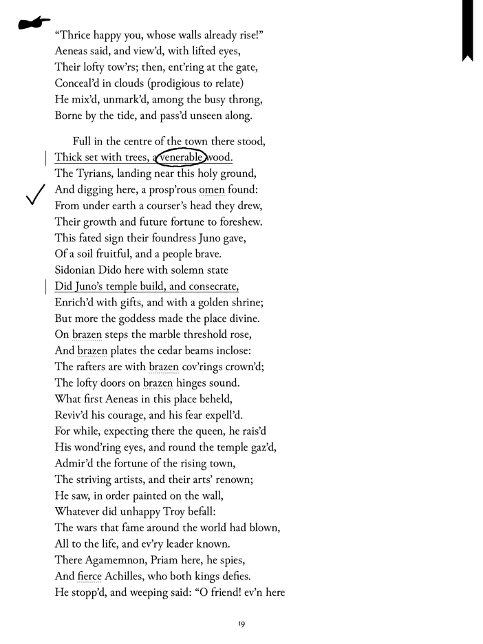
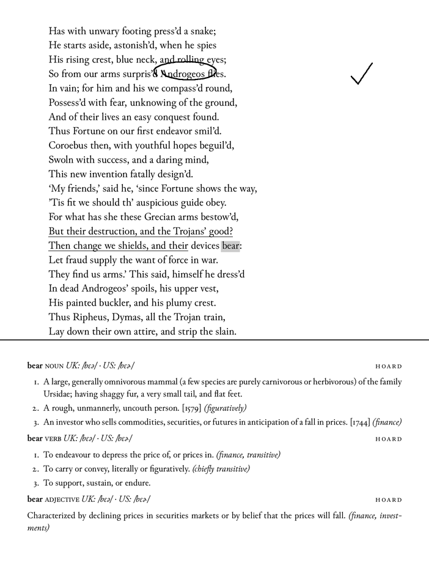
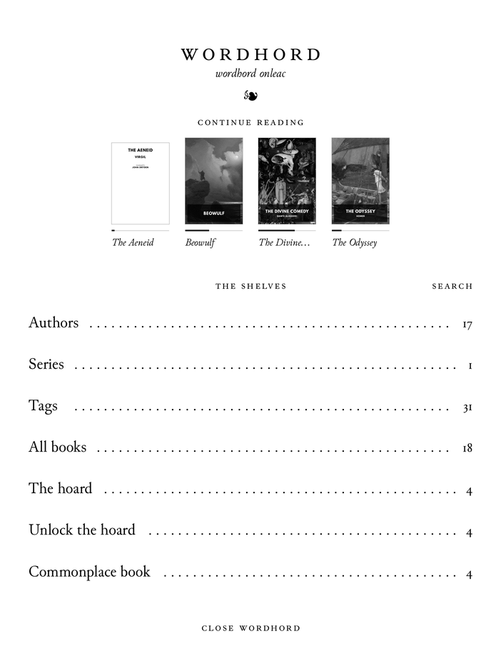
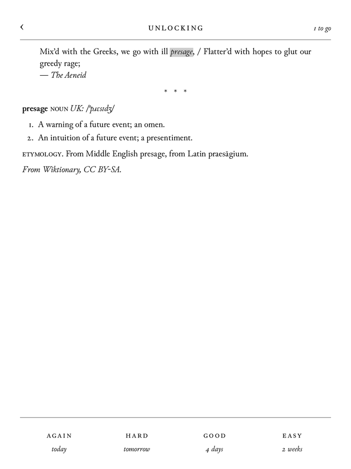
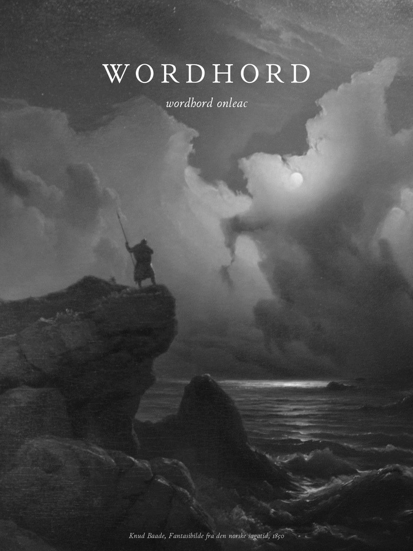

# Wordhord

An opinionated e-reader for Kobos with a pen.

In *Beowulf*, a warden stands on the sea-cliffs and asks the strangers who they are. Beowulf answers him, and the poet says *wordhord onleac*: he unlocked his word-hoard. Wordhord is a reader built around that idea. You read, you keep the words you meet, and you write in the margins.

It runs beside Kobo's own software. You open it from NickelMenu. Nickel pauses while it runs and comes back when you close it. Nothing on the Kobo is replaced.

<p>



</p>

## What it does

**Sets pages like a book.** Wordhord has its own typesetter. It breaks lines the way TeX does, a whole paragraph at a time. Figures are old-style. Verse keeps its lines. There are five faces, each marked with the old languages it can set, and sizes named as printers named them, long primer to great primer.

**Looks up any word you tap.** The dictionary is Wiktionary, offline, and it knows inflected forms: tap *mǫgu* and get *mǫgr*. English, Old English and Old Norse so far. Etymologies lead on: from *hate*, tap Old English *hatian* and it opens too.

**Keeps the words you hoard.** One tap keeps a word with the sentence you found it in. *Unlock the hoard* brings them back as cards, spaced out the way Anki spaces them, so they stay. A word you've kept has a faint dotted line under it wherever you meet it again, and its entry says where you first did.

**Underlines.** Hold a word until it turns grey, drag, and lift. A loupe above your finger shows the word your fingertip hides. Every underline goes into a commonplace book, by book and by day, and you can search it.

**Writes with the pen.** The pen only writes. A full stop is a full stop, never a page turn. Ink belongs to the words it was written by, so it moves with them when you change the type. The other end of the stylus rubs out. Hold its button and a stroke under a line underlines it. Hold an underline and *write* puts a note in your own hand on it. While the pen is near, your hand can rest on the page. A manicule, ☚, tells you so.

**Searches.** A book, the library, the commonplace book. The keyboard has a row of the old letters: þ ð æ ǫ ȝ ƿ œ ø.

**Sleeps under a painting.** Knud Baade's *Scene from the Era of Norwegian Sagas* (1850): the warden on his cliff.

**Keeps your notes as plain files.** Words kept, underlines and ink go into logs in the app's folder, one record a line. Nothing is ever overwritten. Support in [Kollate](https://github.com/andrew-lawlor/kollate), to read them on the desktop, is under way.

<p>


</p>

## What it won't do

No store, no account, no cloud. No copy and paste, since a Kobo has no clipboard. No settings for things that have a right answer. If something can't be done as well as a good printed book does it, it waits.

## Status

Early, and in daily use on a Kobo Elipsa 2E, the only device it has been tested on. Other Kobos with a pen should work but haven't been tried. EPUB only, and DRM-free: books bought from the Kobo store are locked to Kobo's own reader, and stay there. Wordhord counts them at the foot of *All books*, so you know they weren't lost. [SPEC.md](SPEC.md) says what's done, what's next, and why.

## Install

You need a Kobo with [NickelMenu](https://pgaskin.net/NickelMenu/), and Wordhord built from source. Building needs Rust with the `armv7-unknown-linux-musleabihf` target, [cargo-zigbuild](https://github.com/rust-cross/cargo-zigbuild) and zig.

```
git clone --recursive https://github.com/andrew-lawlor/wordhord
cd wordhord
scripts/package-kobo.sh
```

Plug in the Kobo and copy `dist/kobo/.adds/` into the `.adds` folder at its root. Eject it. *Wordhord* is now in NickelMenu. It finds the books already on the Kobo.

Dictionary packs are built from [kaikki.org](https://kaikki.org/)'s extracts of Wiktionary:

```
cargo run -q --bin wordhord -- dictionary non.jsonl non non.sqlite
```

Packs go in `.adds/wordhord/dictionaries/` on the Kobo. `scripts/package-kobo.sh` takes any it finds in `~/.cache/wordhord-tools/kaikki/`.

To try Wordhord on the desktop, with any folder of EPUBs as its library:

```
scripts/try-desktop.sh ~/Books
```

## Old texts

Wordhord began as a reader for old texts: the original and the translation, line by line. That work lives on as *editions*, compiled on the desktop. `books/` holds five, among them Pettit's *Poetic Edda* in Old Norse and English, aligned stanza by stanza. [VOCABULARY.md](VOCABULARY.md) describes their markup.

```
cargo run -q --bin wordhord -- check books/edda-pettit
cargo run -q --bin wordhord -- align books/edda-pettit
```

## Credits and licence

Wordhord is free software under the [GNU GPL, version 3](LICENSE).

It draws the screen with [FBInk](https://github.com/NiLuJe/FBInk), by NiLuJe. Its faces are Junicode, EB Garamond, Cardo, Literata and Atkinson Hyperlegible, all under the SIL Open Font License; see [fonts/README.md](fonts/README.md). The dictionaries come from Wiktionary, under CC BY-SA. The sleep screen is made from a photograph of Baade's painting, CC BY-SA 3.0; see [art/README.md](art/README.md). The editions in `books/` carry their own licences; see [books/README.md](books/README.md).

Much of how Wordhord talks to a Kobo was learned from [KOReader](https://github.com/koreader/koreader).
