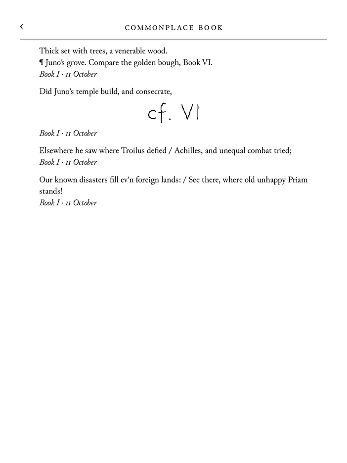
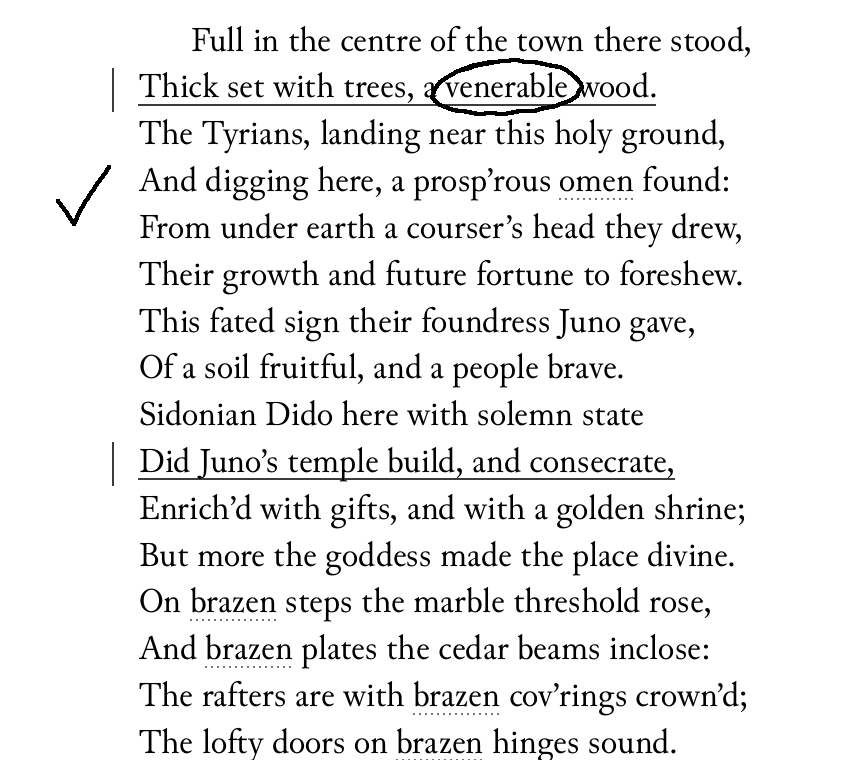
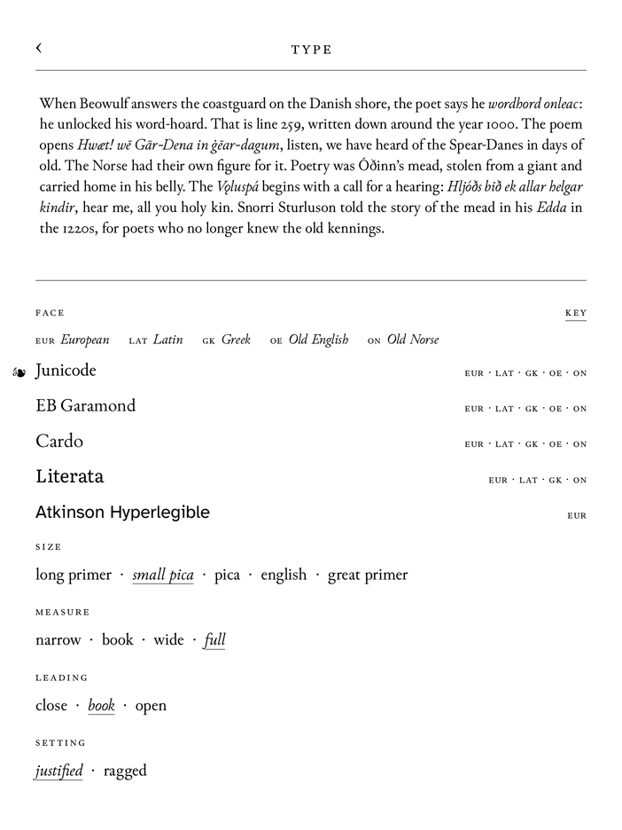
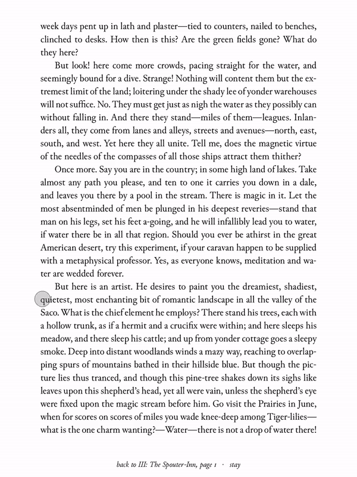
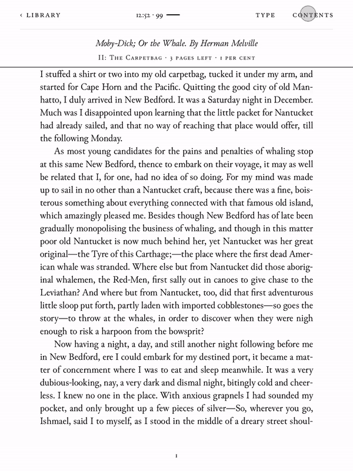
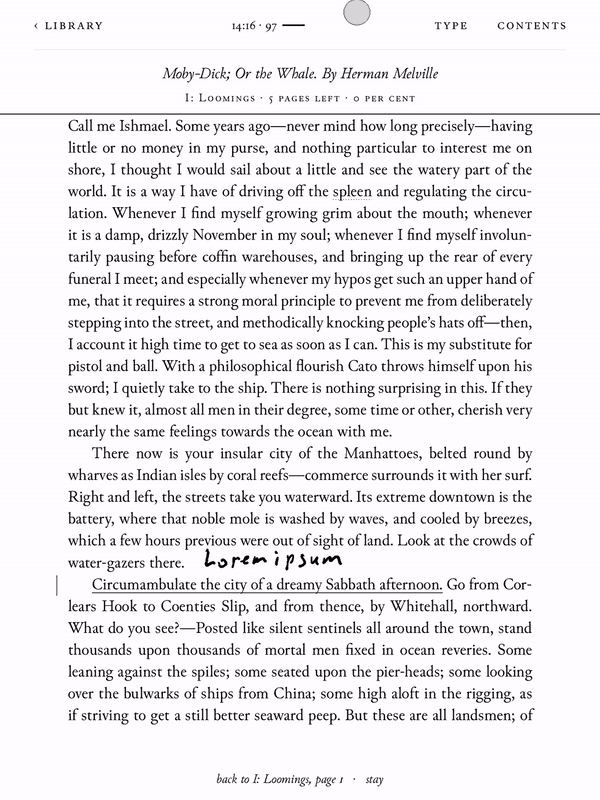
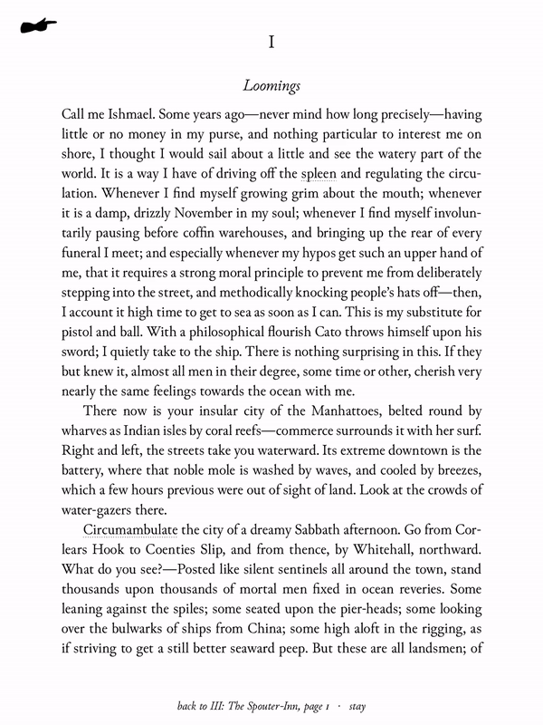
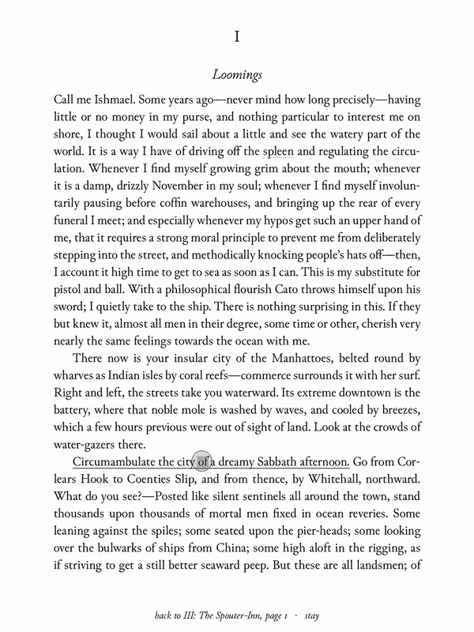
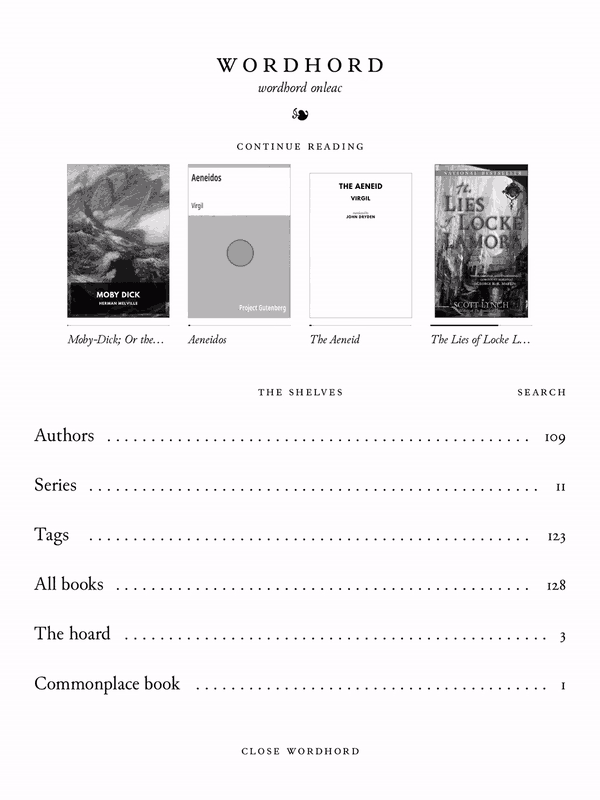
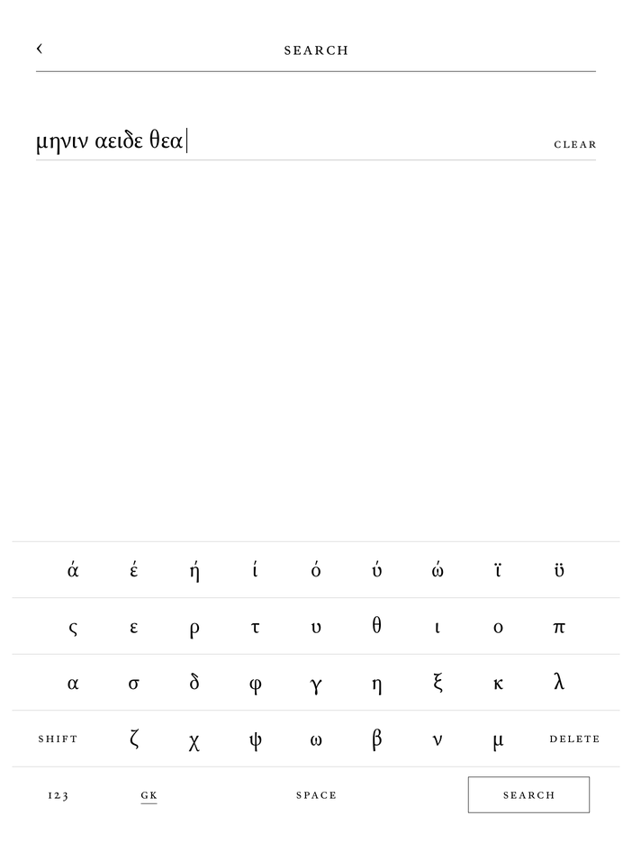

# Wordhord

An opinionated e-reader for Kobo. Better still with a pen.

In *Beowulf*, a warden stands on the sea-cliffs and asks the strangers who they are. Beowulf answers him, and the poet says *wordhord onleac*: he unlocked his word-hoard. Wordhord is a reader built around that idea. You read, you keep the words you meet, and you write in the margins.

Print spent five hundred years learning how to set a page, gloss a word and make room for a reader's hand. E-readers kept little of it. Wordhord puts it back.

<p>



</p>

It runs beside Kobo's own software. You open it from NickelMenu. Nickel pauses while it runs and comes back when you close it. Nothing on the Kobo is replaced.

## The page

**Set like a book.** Wordhord has its own typesetter. It breaks lines the way TeX does, a whole paragraph at a time, so the spacing stays even. Kobo's own reader and KOReader fill one line at a time. Figures are old-style. Small caps are real small caps. Verse keeps its lines.

**Type, chosen against a specimen.** Five faces, each marked with what it can set: *eur* for the languages of Europe, *lat* for Latin's long vowels, *gk* for Greek with its accents and breathings, *oe* for Old English, *on* for Old Norse. A key above the faces spells them out. Sizes have the printers' old names, long primer to great primer. A measure that can't make the line any narrower on your screen is set in grey.

<p>


</p>

## Words

**Tap a word and Wiktionary answers.** Offline, from packs built from Wiktionary. It knows inflected forms: tap *mǫgu* and get *mǫgr*, tap *ἀνθρώπων* and get *ἄνθρωπος*. English, Latin, Ancient Greek, Old English and Old Norse so far. Accents and long marks needn't match. Latin's *-que* comes off: tap *virumque* and get *vir*.

**Follow a word back.** An etymology names a word's ancestors. Where Wordhord has a dictionary for the ancestor's language, the word is underlined, and a tap opens it. *Temple* leads to Latin *templum*, and *templum* on to Old Norse *þǫmb*. *‹ temple* takes you back. Tap your way down a word's whole line.

**Keep the words you meet.** One tap hoards a word with the sentence you found it in. *Unlock the hoard* brings them back as cards, spaced the way Anki spaces them, so they stay.

**Meet them again.** A word you're still learning has a faint dotted line under it wherever it turns up, in any book, in any of its forms. Tap it, and its entry says where you first met it. Once you know a word, the line goes. Forget it, and the line comes back.

<p>



</p>

## The pen

On a Kobo with a pen:

**The pen only writes.** A full stop is a full stop, never a page turn. While the pen is near, your hand can rest on the page, and a pointing hand, ☛, at the top left says so. The other end of the stylus rubs out.

**Ink belongs to its words.** Each stroke is kept with the words it was written by. Change the type and the ink moves with them.

**Underline by hand.** Hold a word until it turns grey, drag, and lift. A loupe above your finger shows the word your fingertip hides. Or hold the pen's button and draw under a line.

**Notes on underlines.** Hold an underline for its card. *Note* types one on ruled lines. *Write* takes one in your own hand. Either way, a sideline in the margin marks it. Like a sticky note, but kept with its passage, and in your hand if you like.

<p>



</p>

<p>


</p>

## Everything else

**The commonplace book.** Every underline gathers there, by book and by day, with its notes, typed or written. Ink from the page is there too, under the line it was written by. Search it. Open it from the library, or from a book's contents.

**Search.** A book, the library, the commonplace book. The keyboard's top row has a language's own letters: Old English, Old Norse, Latin, or Greek, which turns the whole keyboard Greek.

**Ribbons.** Tap the top right corner and a ribbon hangs into the margin, forked like a hardback's silk.

**Sleeps under a painting.** Knud Baade's *Scene from the Era of Norwegian Sagas* (1850): the warden on his cliff.

**Keeps your notes as plain files.** Words kept, underlines, notes and ink go into logs in the app's folder, one record a line. Nothing is ever overwritten. Support in [Kollate](https://github.com/andrew-lawlor/kollate), to read them on the desktop, is under way.

<p>

</p>

## What it won't do

No store, no account, no cloud. No copy and paste, since a Kobo has no clipboard. No settings for things that have a right answer. If something can't be done as well as a good printed book does it, it waits.

## Status

Early, and in daily use on a Kobo Elipsa 2E and a Kobo Libra Colour. A Kobo without a pen gets everything but the ink: you underline with a finger and type your notes. Wordhord lays out pages for the screens it knows, so a Kobo with the same screen as one of those, such as the Libra 2, should work but hasn't been tried. Other screens, like the Clara's or the Sage's, need a profile first: a few lines in `profiles/` giving the screen's size, its resolution and the margins. EPUB only, and DRM-free: books bought from the Kobo store are locked to Kobo's own reader, and stay there. Wordhord counts them at the foot of *All books*, so you know they weren't lost. [SPEC.md](SPEC.md) says what's done, what's next, and why.

## Install

You need a Kobo with [NickelMenu](https://pgaskin.net/NickelMenu/), and Wordhord built from source. Building needs Rust with the `armv7-unknown-linux-musleabihf` target, [cargo-zigbuild](https://github.com/rust-cross/cargo-zigbuild) and zig.

```
git clone --recursive https://github.com/andrew-lawlor/wordhord
cd wordhord
scripts/package-kobo.sh
```

Plug in the Kobo and copy `dist/kobo/.adds/` into the `.adds` folder at its root. Eject it. *Wordhord* is now in NickelMenu. It finds the books already on the Kobo.

Dictionary packs are built from [kaikki.org](https://kaikki.org/)'s extracts of Wiktionary:

```
cargo run -q --bin wordhord -- dictionary non.jsonl non non.sqlite
```

Packs go in `.adds/wordhord/dictionaries/` on the Kobo. `scripts/package-kobo.sh` takes any it finds in `~/.cache/wordhord-tools/kaikki/`. They're large: Latin is about 500 MB, English about 330 MB. Take only the ones you read.

To try Wordhord on the desktop, with any folder of EPUBs as its library:

```
scripts/try-desktop.sh ~/Books
```

## Old texts

Wordhord began as a reader for old texts: the original and the translation, line by line. That work lives on as *editions*, compiled on the desktop. `books/` holds five, among them Pettit's *Poetic Edda* in Old Norse and English, aligned stanza by stanza. [VOCABULARY.md](VOCABULARY.md) describes their markup.

```
cargo run -q --bin wordhord -- check books/edda-pettit
cargo run -q --bin wordhord -- align books/edda-pettit
```

## Credits and licence

Wordhord is free software under the [GNU GPL, version 3](LICENSE).

It draws the screen with [FBInk](https://github.com/NiLuJe/FBInk), by NiLuJe. Its faces are Junicode, EB Garamond, Cardo, Literata and Atkinson Hyperlegible, with Noto fonts for Hebrew, Arabic and Devanagari, all under the SIL Open Font License; see [fonts/README.md](fonts/README.md). The dictionaries come from Wiktionary, under CC BY-SA. Greek and Latin are hyphenated by TeX's own patterns; see [crates/wordhord-typeset/hyphenation/README.md](crates/wordhord-typeset/hyphenation/README.md). The sleep screen is made from a photograph of Baade's painting, CC BY-SA 3.0; see [art/README.md](art/README.md). The editions in `books/` carry their own licences; see [books/README.md](books/README.md).

The screenshots show [Standard Ebooks](https://standardebooks.org/)' editions of Dryden's *Aeneid* and other books in the public domain. Their careful work is worth your support. The moving pictures show their *Moby-Dick*, and Virgil's Latin from [Project Gutenberg](https://www.gutenberg.org/ebooks/227), recorded on a Kobo Elipsa 2E as it was used.

Much of how Wordhord talks to a Kobo was learned from [KOReader](https://github.com/koreader/koreader).
